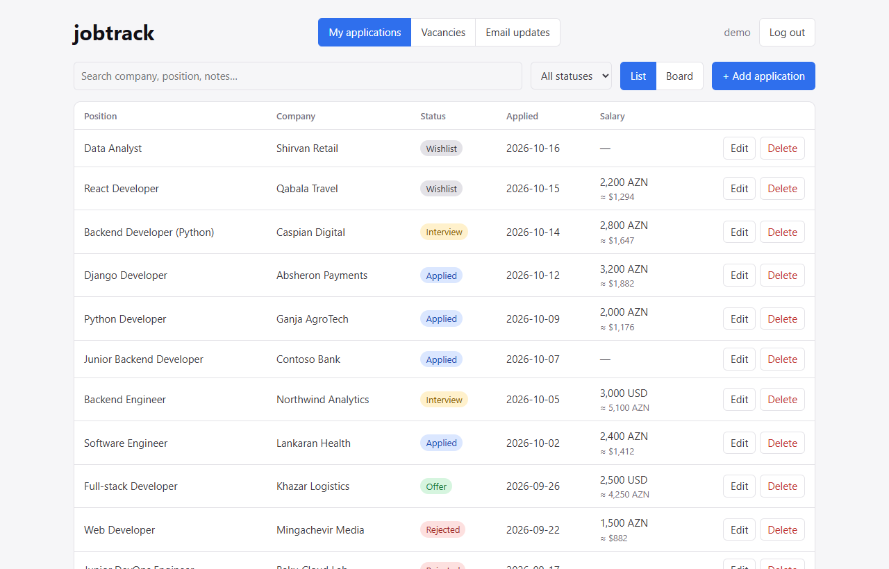
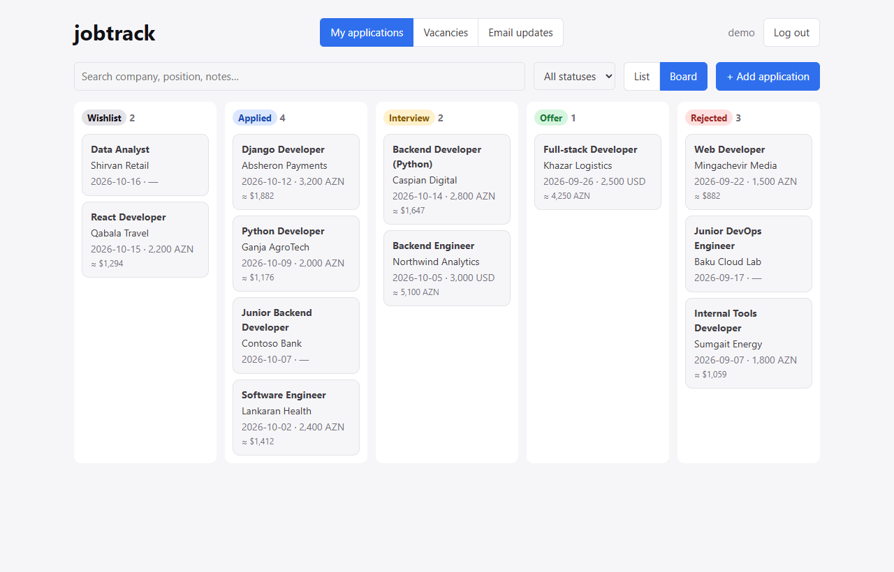
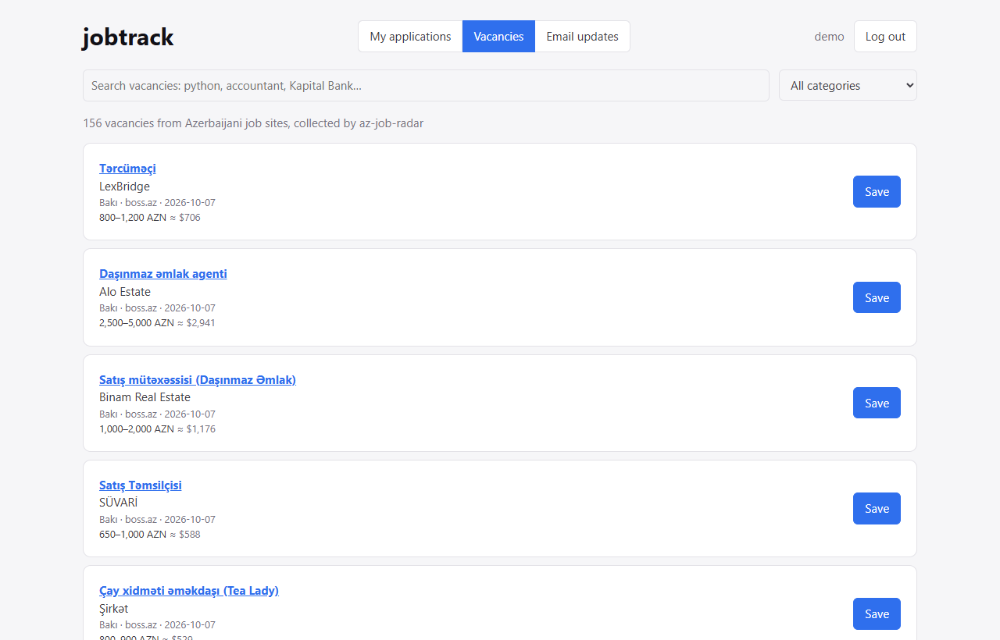
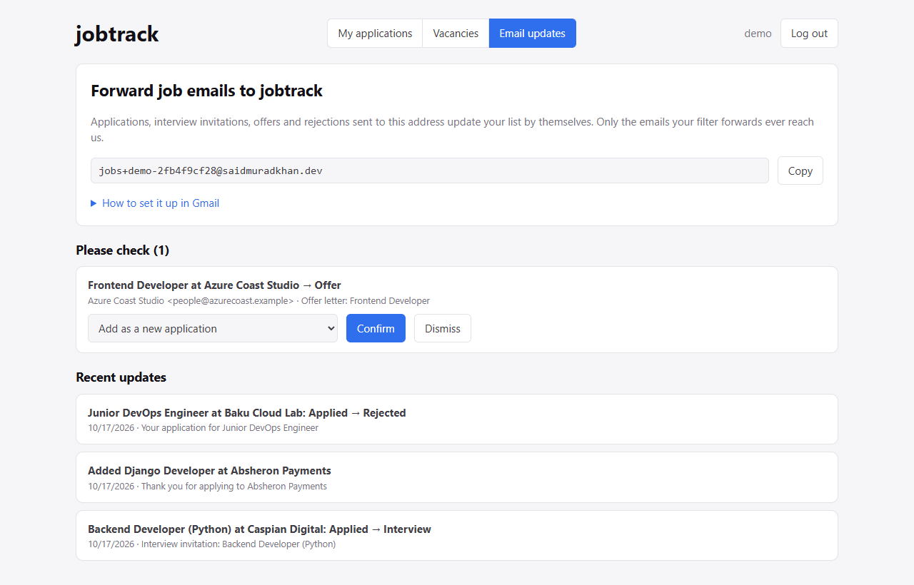
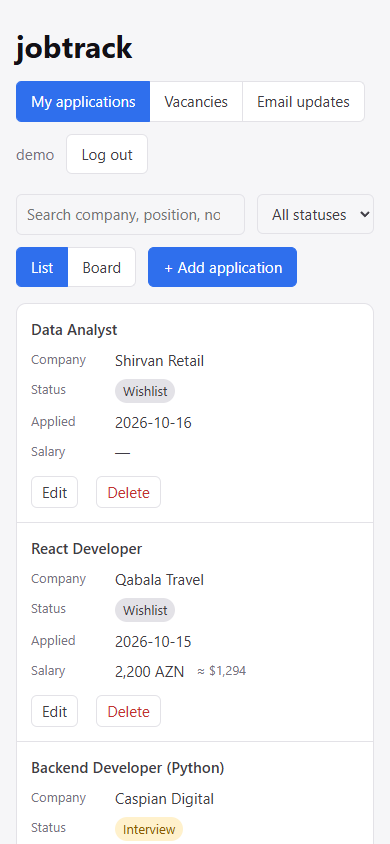

# jobtrack

[](https://github.com/saidmuradkhan/jobtrack/actions/workflows/backend.yml)
[](https://github.com/saidmuradkhan/jobtrack/actions/workflows/frontend.yml)

Full-stack job application tracker: browse vacancies collected by
[az-job-radar](https://github.com/saidmuradkhan/az-job-radar), save the ones you like,
and track every application from "applied" to "offer". Salaries are converted with
[cbar-rates](https://github.com/saidmuradkhan/cbar-rates).

**Live demo:** jobs.saidmuradkhan.dev *(coming soon)*

> Part of a 3-service system: az-job-radar (Python) · cbar-rates (Go) · **jobtrack** (Django + React)

## Features

- **Applications list and board:** add, edit and search applications, or drag cards between
  Wishlist, Applied, Interview, Offer and Rejected
- **Vacancies:** browse jobs from 10 Azerbaijani job sites (via az-job-radar) and save one as an
  application in a click
- **Salaries in two currencies:** every salary also shows in AZN or USD with the official CBAR
  rate (via cbar-rates)
- **Email updates:** forward job emails to a private address and statuses move by themselves
  (applied → interview → offer / rejected), in English, Azerbaijani and Russian
- **Accounts:** sign up and log in with JWT, each user sees only their own data
- **Works on phones:** the list turns into cards on narrow screens
- **Tested:** 133 backend tests (pytest-django) and 37 frontend tests (Vitest), both in CI

## Screenshots

| My applications | Board |
|---|---|
|  |  |

| Vacancies from az-job-radar | Email updates |
|---|---|
|  |  |



The screenshots use the `seed_demo` data. The vacancies come from az-job-radar's saved test
pages, not the live sites.

## Tech stack

- **Backend:** Django · Django REST Framework · JWT auth · PostgreSQL
- **Frontend:** React (Vite) · Vitest · Testing Library
- **Infra:** Vercel · Neon Postgres · GitHub Actions

## Backend API

| Method | Path | Description |
|---|---|---|
| GET | `/health` | Liveness check |
| POST | `/api/auth/register/` | Create an account (`username`, `email`, `password`) |
| POST | `/api/auth/token/` | Log in, returns `access` + `refresh` JWT |
| POST | `/api/auth/token/refresh/` | Get a new access token |
| GET | `/api/auth/me/` | Current user |
| GET, POST | `/api/applications/` | List / create your applications |
| GET, PATCH, PUT, DELETE | `/api/applications/{id}/` | One application |
| GET | `/api/vacancies/?q=&category=&page=` | Vacancies from az-job-radar, 20 per page, with `saved` for the ones you already track |
| GET | `/api/rates/` | Official CBAR rates from cbar-rates (`per_unit` in AZN), cached for an hour |
| GET | `/api/inbox/` | Your forwarding address, the Gmail confirmation code and recent email updates |
| POST | `/api/inbox/emails/{id}/accept/` | Apply an unsure email: to `application` (id) or as a new application |
| POST | `/api/inbox/emails/{id}/dismiss/` | Ignore an unsure email |
| POST | `/api/inbox/receive/` | Webhook for the mail provider (raw email, `X-Inbox-Secret`, `X-Inbox-To`) |

List filters: `?status=interview`, `?search=python` (company, position, notes),
`?ordering=-applied_on` (`applied_on`, `company`, `salary`, `created_at`).
Every request except register/login needs `Authorization: Bearer <access>`,
and each user only ever sees their own applications.

Saving a vacancy creates a `wishlist` application with its `vacancy_uid`; the same
vacancy can't be saved twice by one user.

## Email updates

Every user gets a private address like `jobs+said-ab12cd34ef@saidmuradkhan.dev`.
A Gmail filter forwards job emails there (the "Email updates" tab shows the filter and the
setup steps), so nobody has to connect their whole mailbox and there is no Google app review.

```
Gmail filter ──► Cloudflare Email Routing (rule for jobs@, subaddressing on) ──► deploy/email-worker.js ──► POST /api/inbox/receive/
```

For each email the API (`backend/inbox/`):

1. reads the sender, subject and text (`reading.py`),
2. decides what it is with simple rules in English, Azerbaijani and Russian (`classify.py`):
   application sent, interview, offer, rejection, the Gmail forwarding code, or not about a job,
3. finds the company and position (LinkedIn, Greenhouse and similar emails, or the sender's name),
4. matches it to your applications by company (`"ACME BANK LLC"` = `"Acme Bank"`) and
   position, and moves the status forward (`processing.py`). A late "thanks for applying" never
   undoes an interview.

A confirmation for a company you don't track yet adds a new application. Anything unclear,
such as an offer from an unknown company or two applications at the same company, waits under
"Please check" until you confirm or dismiss it. Older emails are not imported: add those
applications by hand once and later emails keep them up to date.

Only the subject, the sender, the first 280 characters and what was found are stored, never the
full email. Emails that are not about a job keep just the sender and subject.

Try it locally without any mail setup:

```bash
python manage.py receive_email tests/fixtures/emails/interview_az.eml --user said
```

## How the three services talk

```
browser ──► jobtrack frontend ──► jobtrack API ──► az-job-radar  /vacancies
                                              └──► cbar-rates    /rates
```

The browser only talks to the jobtrack API. The API calls the other two services
server-side and sends `X-Preview-Token`, so the shared secret never reaches the browser.

## Configuration

| Variable | Default | Purpose |
|---|---|---|
| `DATABASE_URL` | local SQLite | Postgres link, e.g. the one Neon gives on Vercel |
| `DJANGO_SECRET_KEY` | dev-only key | Required when debug is off |
| `DJANGO_DEBUG` | `1` locally, `0` on Vercel | Debug pages and errors |
| `DJANGO_ALLOWED_HOSTS` | `localhost,127.0.0.1` | Comma separated, e.g. `jobs-api.saidmuradkhan.dev` |
| `RADAR_API_URL` | `https://radar.saidmuradkhan.dev` | az-job-radar base URL |
| `RATES_API_URL` | `https://rates.saidmuradkhan.dev` | cbar-rates base URL |
| `PREVIEW_USER`, `PREVIEW_PASSWORD` | — | Preview login. If either is missing, the site is public. |
| `PREVIEW_SECRET` | — | Signs the preview cookie and is sent as `X-Preview-Token` to the other services (same value everywhere) |
| `FRONTEND_URL` | — | The frontend's address, e.g. `https://jobs.saidmuradkhan.dev`: allowed by CORS and as a place to return to after the preview login |
| `PREVIEW_COOKIE_DOMAIN` | — | e.g. `.saidmuradkhan.dev`, so the frontend's requests carry the preview cookie |
| `INBOX_ADDRESS` | `jobs@saidmuradkhan.dev` | Mailbox the forwarding addresses are built on (`jobs+<user>-<key>@...`) |
| `INBOX_WEBHOOK_SECRET` | — | Shared with the email worker. Without it the webhook is off (`503`). |

While the preview login is on, `/health` stays open, the API answers `401` with a
`preview_login` link and the frontend sends the browser there.

## Run the backend locally

```bash
cd backend
python -m venv .venv
.venv\Scripts\activate        # Windows  (Linux/macOS: source .venv/bin/activate)
pip install -r requirements-dev.txt
python manage.py migrate
python manage.py createsuperuser   # optional, for /admin
python manage.py seed_demo         # optional, a "demo" user with sample data
python manage.py runserver
pytest
```

## Run the frontend locally

With the backend running on `127.0.0.1:8000`:

```bash
cd frontend
npm install
npm run dev        # http://localhost:5173, /api is proxied to the backend
npm test           # Vitest + Testing Library
npm run lint
npm run build
```

Sign up, then add applications from the list view or drag cards between
columns on the board view to change their status.
For a deployed build, set `VITE_API_URL` to the backend URL.

The Vacancies tab needs az-job-radar: either set `PREVIEW_SECRET` for the backend
(the live sites are behind the preview login) or point `RADAR_API_URL` and
`RATES_API_URL` at locally running copies.

## Demo data

`python manage.py seed_demo` creates a `demo` user with 12 applications in every status and a few
email updates, one of them waiting under "Please check". The password comes from `--password`,
then `DEMO_PASSWORD`, otherwise a random one is printed. An existing user's data is only
replaced with `--reset`.

## Deploy (Vercel + Neon)

Two Vercel projects from this repo:

| Project | Root directory | Domain | Settings |
|---|---|---|---|
| API | `backend` | `jobs-api.saidmuradkhan.dev` | Python, entry `index.py` (`vercel.json`) |
| Frontend | `frontend` | `jobs.saidmuradkhan.dev` | Vite, `VITE_API_URL=https://jobs-api.saidmuradkhan.dev` |

For the API, add a Neon database under Storage (it sets `DATABASE_URL`) and set
`DJANGO_SECRET_KEY`, `DJANGO_ALLOWED_HOSTS`, `FRONTEND_URL`, `PREVIEW_COOKIE_DOMAIN` and the
preview and inbox variables above. Debug is off on Vercel unless `DJANGO_DEBUG=1`.

- **Database:** the `Migrate database` workflow runs `migrate` on Neon whenever migrations change
  (or by hand from the Actions tab). It needs the same `DATABASE_URL` as a GitHub secret and
  skips itself without it.
- **CORS:** only `FRONTEND_URL` may call the API, with credentials, so the preview cookie set on
  `.saidmuradkhan.dev` travels with the frontend's requests.
- **Static files:** WhiteNoise serves the admin's CSS and JS straight from the installed apps,
  no `collectstatic` step needed.

## Structure

```
jobtrack/
├── backend/    # Django + DRF API
├── frontend/   # React (Vite) app
└── deploy/     # Cloudflare Email Worker for email updates
```

## Roadmap

- [x] Django project + `applications` app, run dev server
- [x] `Application` model (company, position, status, applied_on, salary, currency, url, notes) + Django admin
- [x] DRF serializers + CRUD API for applications
- [x] User registration & JWT login (`djangorestframework-simplejwt`)
- [x] Each user sees only their own applications (permissions)
- [x] Filtering & search (status, company)
- [x] API tests (pytest-django) + CI
- [x] React frontend: login, applications list, add/edit form
- [x] Kanban board view by status, filter and search
- [x] Frontend tests (Vitest + Testing Library) in CI
- [x] Browse az-job-radar vacancies and save one as an application in a click
- [x] Salaries shown in AZN and USD with official rates from cbar-rates
- [x] Preview login (signed cookie) until review
- [x] Email updates: forward job emails, statuses change by themselves
- [x] PostgreSQL (Neon) through `DATABASE_URL`, SQLite locally
- [x] Vercel config: serverless Django, CORS, static files, migrations workflow
- [x] Demo data command (`seed_demo`)
- [ ] Deploy to jobs.saidmuradkhan.dev

## License

MIT
